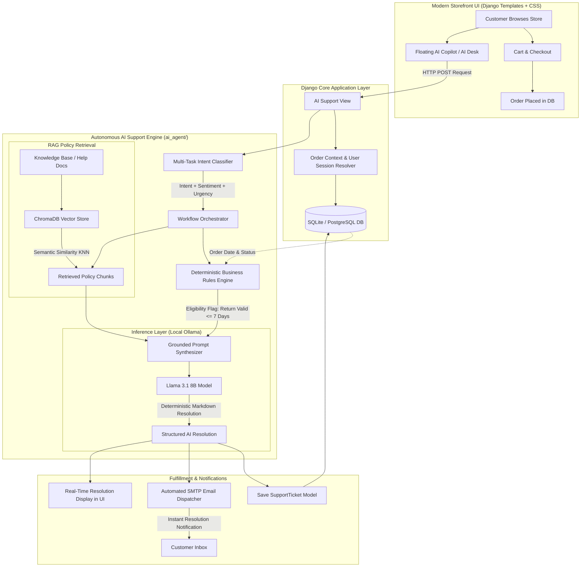
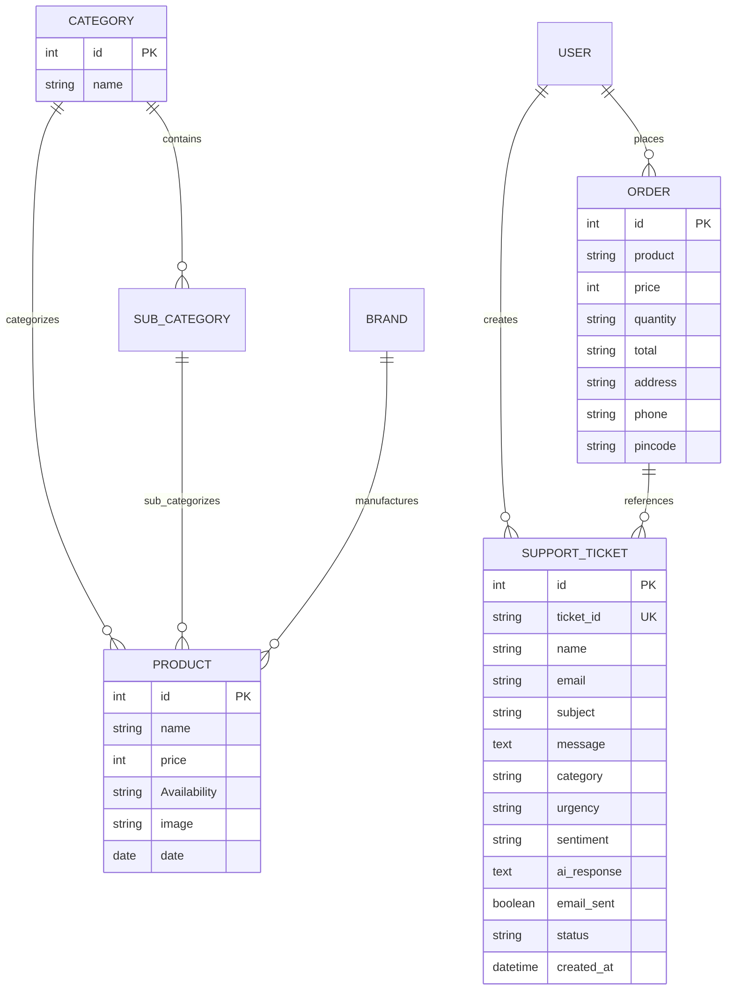

# 🛒 SmartCare-Commerce-AI

### *Autonomous D2C E-Commerce Platform & Agentic AI Customer Support Desk*

[](https://www.python.org/)
[](https://www.djangoproject.com/)
[-FF6F00?logo=ollama&logoColor=white)](https://ollama.ai/)
[](https://www.trychroma.com/)
[](LICENSE)
[]()

---

## 📌 Executive Summary

**SmartCare-Commerce-AI** is an enterprise-grade full-stack electronic commerce platform tightly coupled with an **autonomous, agentic AI customer service desk**. Built to demonstrate modern AI Engineering in a high-traffic consumer environment, the platform eliminates standard tier-1 customer support latency by automating triage, policy lookup, order verification, resolution generation, and email dispatch into an end-to-end autonomous pipeline.

Traditional e-commerce customer support workflows suffer from an average **12 to 24-hour turnaround time** for basic inquiries—such as size exchanges, package transit updates, and damaged item complaints. **SmartCare-Commerce-AI** resolves these disputes in **under 5 seconds** using a hybrid architecture that combines local Large Language Model (LLM) reasoning, vector Semantic Search (RAG), and deterministic database-level business validation.

---

## 🏛️ System Architecture & Data Flow



---

## ⚡ Core Platform Capabilities

### 1. 🛍️ Modern D2C E-Commerce Storefront
* **Sticky Glassmorphic Header**: Blur-backed navigation header featuring promotional announcement strips, real-time live AI agent status indicator, dynamic cart badge count, and search.
* **Smart Catalog & Interactive Filter Chips**: Instant category and brand filtering without layout shift or page reload overhead.
* **High-Conversion Product Detail Page (PDP)**:
  * Dynamic size selector pills (`S`, `M`, `L`, `XL`, `XXL`).
  * Real-time stock status badge (*"In Stock • Ready to Dispatch"*).
  * Trust guarantee indicators (Free Express Delivery, 7-Day Returns, 100% Genuine).
  * Direct deep-link button to open the **AI Support Desk with the selected product pre-filled**.
* **Shopping Bag & Order Summary**:
  * Free Express Shipping progress meter tracking unlock threshold.
  * Real-time quantity stepper controls (`+` / `-`).
  * Frictionless checkout modal with cash-on-delivery (COD) and online gateway integrations.
* **Order History Dashboard**: Comprehensive purchase ledger featuring order status tags, shipping details, and a 1-click **"Raise AI Ticket"** trigger per item.
* **Interactive Feedback System**: 5-star animated rating widget with verified buyer badges.

---

### 2. 🤖 Autonomous AI Customer Support Desk
* **Zero-Hallucination Policy Retrieval (RAG)**: Uses dense vector embeddings to ground the model strictly in the store's official return, refund, cancellation, and shipping guidelines.
* **Contextual Order Verification**: When a customer links an order ID, the agent automatically cross-references the order date in the database to calculate if the item is within the **7-day return policy**.
* **Multi-Task Triage**: Simultaneously extracts:
  * **Category**: `Return / Refund`, `Order Tracking`, `Damaged Item`, `Size Exchange`, `General Inquiry`.
  * **Sentiment**: `Positive`, `Neutral`, `Frustrated`, `Angry`.
  * **Urgency**: `Low`, `Medium`, `High`, `Critical`.
* **Autonomous Email Dispatch**: Automatically composes and sends a professional confirmation email containing the ticket ID, policy rationale, and resolution steps directly to the customer's verified email address.
* **Persistent Audit Trail**: All customer interactions are saved as `SupportTicket` records in the database with unique alphanumeric ticket identifiers (`TKT-XXXXXXXX`) accessible to store administrators.

---

## 🧠 AI Engineering Deep-Dive

### A. Intent Classification & Schema Enforcement
The input message is processed by a zero-shot classification system that forces strict JSON schema validation.

```python
# Sample Classification Output
{
    "category": "return_refund",
    "urgency": "medium",
    "sentiment": "neutral",
    "requires_human_escalation": false
}
```

### B. Retrieval-Augmented Generation (RAG) Architecture
* **Vector Store**: Local ChromaDB instance indexing structured knowledge documents (`shipping_delivery.txt`, `returns_refunds.txt`, `cancellations.txt`, `general_faq.txt`).
* **Embedding Model**: `nomic-embed-text` generating 768-dimensional vector representations.
* **Grounded Synthesis**: Retrieved policy excerpts are injected into a constrained system prompt, instructing the LLM to refuse speculative claims outside the provided policy context.

### C. Deterministic Business Logic Integration
Pure LLMs can hallucinate dates and policy eligibility. **SmartCare-Commerce-AI** enforces hard software gates:
```python
# Example: Return Eligibility Rule Gate
order_date = order.date
days_since_purchase = (datetime.date.today() - order_date).days

if days_since_purchase <= 7:
    eligibility_context = f"Order #{order.id} was placed {days_since_purchase} days ago. ELIGIBLE for return/exchange."
else:
    eligibility_context = f"Order #{order.id} was placed {days_since_purchase} days ago. EXCEEDS 7-day return policy."
```

---

## 🗄️ Database Architecture



---

## 📁 Repository Directory Structure

```text
SmartCare-Commerce-AI/
├── ai_agent/                          # Autonomous AI Engine Subsystem
│   ├── agent.py                       # Orchestrator & Multi-Step LLM Workflow
│   ├── retriever.py                   # Vector Store & Semantic Search Loader
│   ├── email_service.py               # SMTP Automation & Email Dispatcher
│   └── knowledge_base/                # Grounding Policy Documents
│       ├── returns_refunds.txt
│       ├── shipping_delivery.txt
│       ├── cancellations.txt
│       └── general_faq.txt
│
├── app/                               # Core Django Application
│   ├── models.py                      # Data Models (Product, Order, SupportTicket)
│   ├── admin.py                       # Django Admin Back-Office Panel
│   ├── forms.py                       # User & Feedback Forms
│   └── migrations/                    # Database Migrations
│
├── E_shop/                            # Project Configuration & URL Routing
│   ├── settings.py                    # Environment & Security Configuration
│   ├── urls.py                        # Master URL Dispatcher
│   ├── views.py                       # Storefront & AI Desk Controller Views
│   └── wsgi.py
│
├── static/                            # Static Frontend Assets
│   ├── css/
│   │   ├── modern_store.css           # 2026 Custom Design System & Variables
│   │   ├── bootstrap.min.css
│   │   └── font-awesome.min.css
│   ├── js/                            # Interactive UI Scripts
│   └── images/                        # Product Catalog & Brand Assets
│
├── templates/                         # Django Template Layer
│   ├── master.html                    # Base Glassmorphic Layout & Sticky Header
│   ├── index.html                     # Hero Banner, Category Chips & Product Grid
│   ├── product.html                   # Catalog Filtering & Grid
│   ├── product_detail.html            # PDP with Size Pills & AI Desk Trigger
│   ├── ai_support.html                # Autonomous Support Desk & Live Triage
│   ├── ticket_detail.html             # Customer Ticket Tracker & Status Ledger
│   ├── order.html                     # Order History & 1-Click Ticket Resolver
│   ├── contact.html                   # Contact Page with AI Assistant Callout
│   ├── feedback.html                  # 5-Star Interactive Customer Review Form
│   └── cart/
│       └── cart_detail.html           # Bag with Free Shipping Meter & Checkout
│
├── db.sqlite3                         # Local SQLite Database
├── manage.py                          # Django CLI Utility
└── requirements.txt                   # Production Python Dependencies
```

---

## 🛠️ Tech Stack & Dependencies

| Component | Technology | Rationale |
| :--- | :--- | :--- |
| **Backend Framework** | Django 5.1.3 | Robust ORM, secure session management, production stability. |
| **AI Inference** | Ollama (Llama 3.1 8B) | Zero data leakage, low-latency local execution, zero API billing. |
| **Vector Search** | ChromaDB + nomic-embed | Compact, high-accuracy semantic retrieval for dense policy matching. |
| **Frontend Architecture**| Semantic HTML5 + Custom Modern CSS | Ultrafast render times, responsive glassmorphic cards, zero framework bloat. |
| **Email Service** | Python SMTP + SSL/TLS | Automated ticket delivery and real-time resolution notifications. |
| **Payment Integration** | Paytm Checksum & Razorpay Ready | Encrypted Indian & global payment gateway support. |

---

## 🚀 Getting Started

### 1. Prerequisites
Ensure you have the following installed on your machine:
* **Python 3.11 or 3.12**
* **Ollama** ([Download Ollama](https://ollama.ai/))
* **Git**

### 2. Pull the AI Models via Ollama
Open your terminal and pull the LLM and embedding models:
```bash
ollama pull llama3.1
ollama pull nomic-embed-text
```

### 3. Clone Repository & Create Virtual Environment
```bash
git clone https://github.com/mishrarakesh-1902/E-commerce.git SmartCare-Commerce-AI
cd SmartCare-Commerce-AI

# Create virtual environment
python -m venv venv

# Activate virtual environment
# Windows:
venv\Scripts\activate
# macOS / Linux:
source venv/bin/activate
```

### 4. Install Dependencies
```bash
pip install -r requirements.txt
```

### 5. Apply Migrations & Initialize Database
```bash
python manage.py makemigrations
python manage.py migrate
```

### 6. Create Superuser (Admin Dashboard)
```bash
python manage.py createsuperuser
```

### 7. Run the Development Server
```bash
python manage.py runserver 8001
```

Now open **`http://127.0.0.1:8001/`** in your web browser.

---

## 🌐 Application Route Directory

| Route Path | Description | Access Level |
| :--- | :--- | :--- |
| **`/`** | Homepage with Hero Carousel, Trust Strip & Curated Drops | Public |
| **`/product/`** | Store Catalog with interactive Category & Brand Filter Chips | Public |
| **`/product/<id>`** | Product Detail Page with Size Selector & AI Query Box | Public |
| **`/cart/cart-detail/`** | Shopping Bag with Free Delivery Meter & Checkout Modal | Authenticated |
| **`/order/`** | Customer Order History with 1-Click AI Ticket Trigger | Authenticated |
| **`/ai-support/`** | Autonomous AI Support Desk & Live Resolution Portal | Public / Auth |
| **`/ai-support/ticket/<id>/`** | Dedicated Support Ticket Tracker & Email Dispatch Log | Public / Auth |
| **`/feedback/`** | 5-Star Interactive Customer Review & Feedback Form | Public |
| **`/contact_us/`** | Contact Hub with 24/7 AI Agent Integration | Public |
| **`/admin/`** | Administrative Back-Office Management Portal | Superuser |

---

## 🧪 AI Support Desk Demo Scenarios

Try these scenarios in the AI Support Desk (`/ai-support/`) to see the multi-step agent reasoning in action:

1. **Size Exchange Inquiry**:
   * *Subject*: `Size Exchange Request`
   * *Message*: `I bought a shirt last week but the medium size is slightly tight. Can I exchange it for a large?`
   * *AI Result*: Diagnoses category as `size_exchange`, queries the 7-day policy, verifies return window, and provides step-by-step courier pickup instructions.
2. **Damaged Shipment**:
   * *Subject*: `Received Damaged Package`
   * *Message*: `My box arrived torn and the jacket zipper is completely broken.`
   * *AI Result*: Flags urgency as `high`, expresses customer empathy, initiates immediate replacement protocol, and confirms reverse pickup scheduling.
3. **Tracking & Delivery**:
   * *Subject*: `Where is my delivery?`
   * *Message*: `Can you check the delivery timeline for my recent order?`
   * *AI Result*: References standard 2 to 4-day shipping windows, asks for tracking verification, and logs ticket.

---

## 🔒 Privacy & Production Principles

* **100% Local Inference**: Customer queries and personal data stay on your infrastructure using local Ollama instances—preventing third-party API exposure.
* **Deterministic Guardrails**: Financial adjustments and policy approvals are guarded by Python business rules rather than raw probabilistic LLM outputs.
* **Fail-Safe Fallbacks**: If the local AI model is offline or uninitialized, the system gracefully falls back to deterministic rule-based triage and notifies human administrative operators without service interruption.

---

## 📄 License
This project is open-source and licensed under the **MIT License**.
